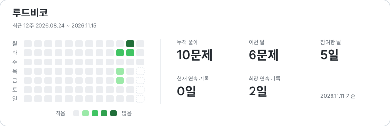
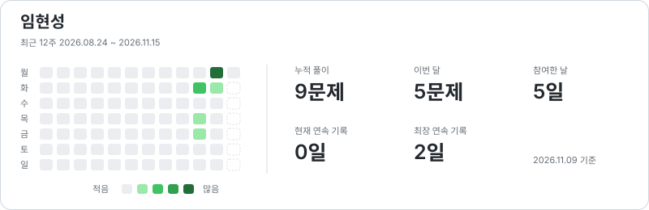
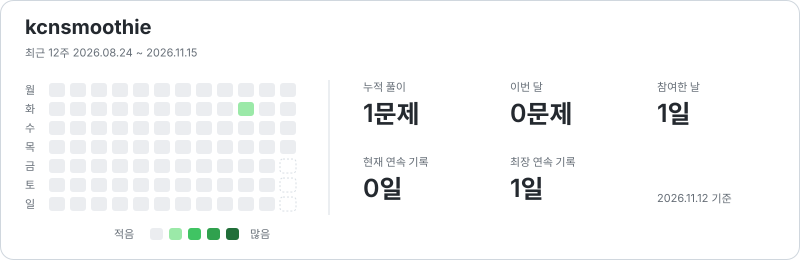
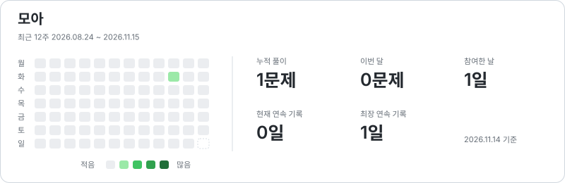

# Coding Grass

함께 푼 문제, 꾸준히 쌓이는 기록.

노션의 코딩 테스트 참여 기록을 모아 사람별 잔디로 보여줍니다.

**4명**이 함께 풀어 온 **10개 문제**

기록 동기화 2026. 11. 04. 15:02 (서울 시간)

## 함께 쌓은 잔디

칸 하나는 하루입니다. 같은 날 여러 문제에 참여할수록 초록색이 진해집니다.

## 최근 푼 문제

| 날짜 | 문제 | 참여자 |
| --- | --- | --- |
| 2026-11-03 | [단어 변환](https://school.programmers.co.kr/learn/courses/30/lessons/43163) | 루드비코 |
| 2026-11-03 | [게임 맵 최단거리](https://school.programmers.co.kr/learn/courses/30/lessons/1844) | 루드비코, 임현성 |
| 2026-11-02 | [네크워크](https://school.programmers.co.kr/learn/courses/30/lessons/43162) | 임현성, 루드비코 |
| 2026-11-02 | [택배 상자 꺼내기](https://school.programmers.co.kr/learn/courses/30/lessons/389478) | 루드비코, 임현성 |
| 2026-11-02 | [타겟 넘버](https://school.programmers.co.kr/learn/courses/30/lessons/43165) | 루드비코, 임현성 |
| 2026-11-02 | [가장 많이 받은 선물](https://school.programmers.co.kr/learn/courses/30/lessons/258712) | 루드비코, 임현성 |
| 2026-10-30 | [개인정보 수집 유효기간](https://school.programmers.co.kr/learn/courses/30/lessons/150370) | 루드비코, 임현성 |
| 2026-10-29 | [공원산책](https://school.programmers.co.kr/learn/courses/30/lessons/172928) | 루드비코, 임현성 |
| 2026-10-27 | [달리기 경주](https://school.programmers.co.kr/learn/courses/30/lessons/178871) | 루드비코, 임현성, kcnsmoothie, 모아 |
| 2026-10-27 | [숫자 짝꿍](https://school.programmers.co.kr/learn/courses/30/lessons/131128) | 루드비코, 임현성 |

집계 기준과 자동 갱신

- 문제 DB에 지정된 날짜와 참여자로 집계합니다.
- 날짜는 서울 시간대 기준이며, 미래 기록은 풀이 통계에서 제외합니다.
- 현재 연속 기록은 오늘 또는 어제까지 이어진 참여일을 셉니다.
- GitHub Actions가 매시 17분과 47분에 노션 동기화와 이미지 갱신을 실행합니다.
- 노션 토큰 등록 전에는 기존 스냅샷으로 표시합니다. 기록 동기화 시각을 확인해 주세요.

[연결 설정과 로컬 실행](docs/setup.md)

